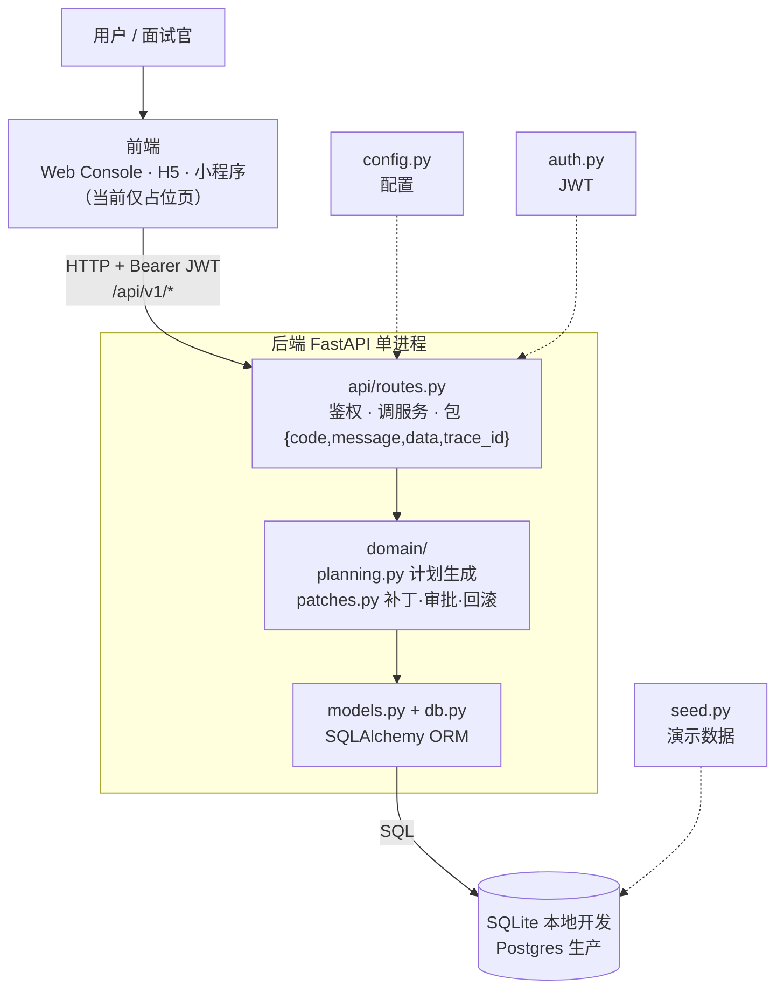
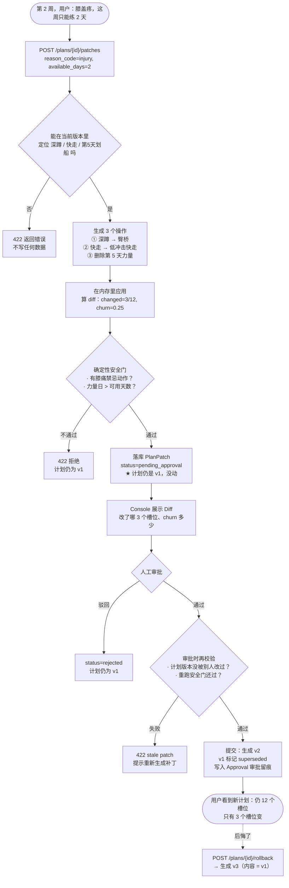
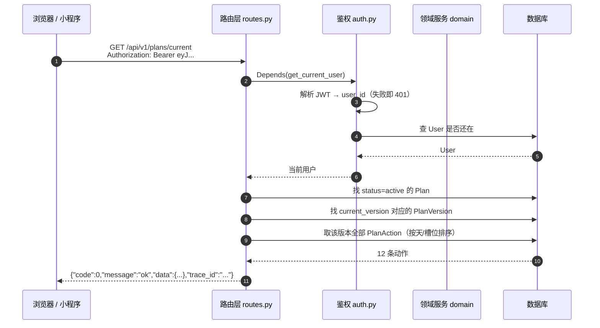
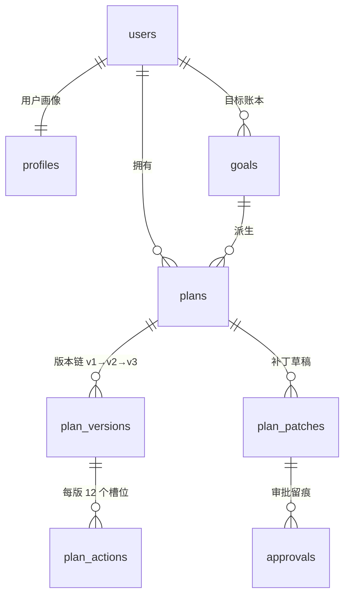

# 10 代码地图与流程图

> 面向「看得懂 Java、但不太熟 Python」的读者。看完这一页，你应该能说清：
> 代码分成哪几层、一次点击在服务器里走了哪几步、膝痛补丁为什么是「安全 + 低 churn + 可回滚」。

---

## 一、一句话说清这个项目

用户在**第 2 周**说「膝盖疼，这周只能练 2 天」。
普通 Agent 会整份计划重新生成（可能又塞回深蹲、跑步）；本项目只提交**3 个槽位的最小补丁**，
经过**确定性安全门**和**人工审批**后生成新版本，随时可回滚。

所以代码里只有两条业务主线：

| 主线 | 入口 | 代码位置 |
| --- | --- | --- |
| 生成计划 | `POST /api/v1/plans/generate` | `backend/app/domain/planning.py` |
| 修复计划（核心） | `POST /api/v1/plans/{id}/patches` → `approve` / `reject` / `rollback` | `backend/app/domain/patches.py` |

---

## 二、目录结构（当前仓库真实状态）

```
planharness/
├── README.md                      产品定位、锁定决策、接口清单
├── .env.example                   ★ 环境变量模板（只放占位符，可提交）
├── .env                           本地真实配置（已被 .gitignore 忽略）
├── docs/                          01-10 设计文档，本文件是第 10 篇
├── deploy/                        生产部署：systemd + Nginx + 现有 Postgres
├── Caddyfile / docker-compose.example.yml
│                                  备选方案，当前不用（见 deploy/README.md）
├── frontend/dist/index.html       占位页（H5 还没开始写）
│
└── backend/                       ★ 唯一可运行的服务：Python / FastAPI
    ├── pyproject.toml             依赖清单（≈ pom.xml）
    ├── uv.lock                    依赖锁文件（≈ Gradle lock）
    ├── app/
    │   ├── main.py                应用入口：建表 → 灌种子数据 → 装中间件 → 挂路由
    │   ├── config.py              配置读取（环境变量 / .env）
    │   ├── db.py                  数据库连接：Engine + Session 工厂
    │   ├── models.py              12 张表的 ORM 定义（≈ JPA Entity）
    │   ├── schemas.py             接口出入参（≈ DTO）
    │   ├── auth.py                JWT 签发/解析、当前用户依赖
    │   ├── seed.py                演示数据：demo 用户 + v1 计划 12 个动作
    │   ├── api/routes.py          所有 HTTP 接口（≈ @RestController）
    │   └── domain/
    │       ├── planning.py        目标计算 + 计划组装 + 两道校验
    │       └── patches.py         ★ 补丁 / 安全门 / 审批 / 回滚
    └── tests/                     12 个 pytest 用例（api / planning / patches）
```

一句话记法：**`api/` 管「怎么进来」，`domain/` 管「对不对」，`models.py` 管「怎么存」。**

---

## 三、Python ↔ Java 概念对照

读代码时把左边替换成右边，基本就通了。

| 本项目里的东西 | Python 世界叫法 | 你在 Java 里见过的对应物 |
| --- | --- | --- |
| `app/main.py` 的 `create_app()` | 应用工厂 | `SpringApplication.run()` / `@SpringBootApplication` |
| `api/routes.py` 的 `@router.get(...)` | 装饰器（=Java 注解） | `@GetMapping` / `@RestController` |
| `schemas.py` | Pydantic 模型 | DTO + Bean Validation |
| `auth.py` 的 `Depends(get_current_user)` | 依赖注入（参数级） | `@AuthenticationPrincipal` |
| `domain/*.py` | 领域服务 | `@Service` |
| `models.py` | SQLAlchemy ORM | JPA `@Entity` |
| `db.py` | Engine / Session | `DataSource` / `SessionFactory` |
| `config.py` | pydantic-settings | `application.yml` + `@ConfigurationProperties` |
| `pyproject.toml` + `uv.lock` | 包管理 | `pom.xml` + `mvn` |
| `uvicorn app.main:app` | ASGI 服务器 | 内嵌 Tomcat |
| `tests/test_*.py` | pytest | JUnit |
| `def` / 缩进 / `self` | 函数 / 代码块 / 实例 | 方法 / `{}` / `this` |
| `str \| None` | 类型标注（仅提示 + 校验） | `@Nullable String` |
| `"""..."""` 开头那段 | docstring | JavaDoc |

有三个「Python 特有」但很容易习惯的点：

1. **类型标注不强制**：`def create_plan(db: Session, user: User) -> Plan:` 里的类型只用于 IDE 提示和框架校验，运行期不会自动检查。
2. **没有 `{}`，靠缩进划分代码块**：缩进错 = 语法错。
3. **异常到处显式抛出**：`raise PatchValidationError([...])` 相当于 `throw new XxxException(...)`，最终由 `routes.py` 统一翻译成 HTTP 422。

---

## 四、整体架构：谁调用谁



**为什么业务规则不放路由里？**
路由只做三件事：认人（JWT）、调服务、把异常翻译成 HTTP 状态码。
所有「能不能这么改、改了是否安全」的判断都在 `domain/`，这样 Console、小程序、测试三端共用同一套规则。

---

## 五、核心业务流程图：膝痛补丁的一生

这是整个项目最需要讲清楚的一张图。



三个设计要害，面试时最值得讲：

1. **审批前不落盘**：`create_knee_patch` 只写 `plan_patches` 草稿，`plan_versions` 一行不动。
2. **安全门跑两遍**：生成补丁时跑一次，审批提交前再跑一次，防止中间状态漂移。
3. **回滚不是改指针**：回滚也是「再提交一个新版本」，所以 v1 → v2 → v3 全在库里，审计链完整。

---

## 六、时序图：一次 HTTP 请求在服务器里走了什么

以 `GET /api/v1/plans/current` 为例。



**统一响应格式**是这个项目的一条硬约定（前端只判断 `code` 和 `data`）：

```json
{ "code": 0, "message": "ok", "data": { }, "trace_id": "3f2a..." }
```

`trace_id` 由 `main.py` 里的中间件生成（也可以由调用方通过 `X-Trace-Id` 传入），响应头里同样带一份，方便排查。

---

## 七、数据模型速查（12 张表，先记 5 张）



| 表 | 一句话 | 你只要记住 |
| --- | --- | --- |
| `plans` | 一份长期计划 | `current_version` 指向「现在生效的是第几版」 |
| `plan_versions` | 计划版本（只增不改） | 被替换的版本标 `superseded`，永不删除 |
| `plan_actions` | 版本里的 12 个动作 | 用 `slot_key`（如 `1:strength:1`）唯一定位 |
| `plan_patches` | 一个待审批补丁 | `operations` 是一份**受限的改动清单**，不是自由文本 |
| `approvals` | 谁在何时放行/驳回 | 只追加，作为审计证据 |
| `users` / `profiles` | 账号 / 身体画像 | 画像决定热量、蛋白质、能做什么动作 |
| `goals` / `constraints` | 目标 / 约束账本 | `constraints` 是 P1 上下文 Harness 的落点 |
| `checkins` / `reviews` | 每日打卡 / 周复盘 | 补丁的触发信号来源 |
| `agent_runs` | Agent 运行记录 | trace、token、耗时，Console 用 |

**三个必须会解释的词**：

- `slot_key` = `天:槽位:序号`，例如 `1:strength:1`。补丁就是靠它精确指出「我改的是哪个格子」。
- `churn` = 改动槽位数 ÷ 总槽位数。3/12 = **25%**，这是「最小补丁」的量化证据。
- `pending_approval` → `committed` / `rejected`，补丁的状态机，只有 `committed` 才产生新版本。

---

## 八、怎么把它跑起来（3 步）

```bash
cd planharness/backend

# 1) 装依赖（README 推荐 uv；没有 uv 就用 venv + pip）
uv sync
#   或：python3.12 -m venv .venv && .venv/bin/pip install -e .

# 2) 起服务（自动重载，改代码立即生效）
uv run uvicorn app.main:app --reload --port 8000

# 3) 打开接口文档（相当于 Swagger UI，能直接在网页上点着试）
open http://127.0.0.1:8000/docs
```

> `/docs` 的 Swagger UI 是**本地静态文件**（`backend/app/static/swagger/`），不走 CDN。
> 因为 FastAPI 默认从 `cdn.jsdelivr.net` 拉 JS，国内常被重置 → 页面白屏（接口本身没坏）。
> 判断方法：白屏时 `curl -s localhost:8000/docs` 若能看到 HTML，就说明是前端资源没加载。

跑测试：

```bash
cd planharness/backend
.venv/bin/python -m pytest -q     # 期望 12 passed
```

验证核心剧情（命令行版，`/docs` 里点也行）：

```bash
TOKEN=$(curl -s -X POST localhost:8000/api/v1/auth/demo -H 'Content-Type: application/json' -d '{}' \
  | python3 -c 'import sys,json;print(json.load(sys.stdin)["data"]["access_token"])')

# 看当前计划（v1，12 个动作）
curl -s localhost:8000/api/v1/plans/current -H "Authorization: Bearer $TOKEN"

# 造一个膝痛补丁（此时计划仍然是 v1）
curl -s -X POST localhost:8000/api/v1/plans/00000000-0000-0000-0000-000000000101/patches \
  -H "Authorization: Bearer $TOKEN" -H 'Content-Type: application/json' \
  -d '{"reason_code":"injury","available_days":2}'
```

---

## 九、建议的读代码顺序（不用全看）

| 顺序 | 文件 | 看什么 | 用时 |
| --- | --- | --- | --- |
| 1 | `README.md` | 产品要解决什么问题 | 5 分钟 |
| 2 | `backend/app/models.py` | 有哪些表、字段什么意思 | 10 分钟 |
| 3 | `backend/app/seed.py` | 演示数据长什么样（v1 的 12 个动作） | 5 分钟 |
| 4 | `backend/app/api/routes.py` | 一共几个接口，各自干什么 | 10 分钟 |
| 5 | `backend/app/domain/patches.py` | **核心**：补丁 → 安全门 → 审批 → 回滚 | 20 分钟 |
| 6 | `backend/app/domain/planning.py` | 热量/蛋白质怎么算、为什么会被拒 | 15 分钟 |
| 7 | `backend/app/main.py` | 这些东西是怎么被组装起来的 | 5 分钟 |

时间紧就只看 2、4、5。

---

## 十、术语表

| 术语 | 含义 |
| --- | --- |
| 安全门（Safety Gate） | 一组**确定性**检查（代码写死，不交给模型判断），如膝痛禁忌动作、热量下限 |
| 最小补丁 | 只改动必要槽位，不重新生成整份计划 |
| churn | 计划被改动的比例；越低越「稳定」 |
| 审批 | 人工确认后才允许写库，避免 Agent 越权 |
| 回滚 | 以历史版本内容再提交一个新版本，历史不被改写 |
| superseded | 被新版本替换掉的旧版本状态 |
| 模板兜底 | LLM 不可用/未配置时，用确定性模板生成计划 |
| A/B/C 模式 | A 裸奔（全量重生成）、B 只加安全门、C 补丁模式（本项目主张） |

---

## 十一、这个项目到底算什么架构？（不是 DDD）

> 本节是速览版；完整版（分层规则、聚合边界、状态机、9 条 ADR、技术债）见 [12 架构总结](12-architecture.md)。

### 一句话

**分层单体（Layered Monolith）+ 服务层（Service Layer）+ 贫血领域模型**；
在核心的「计划修复」用例上借用了 DDD 的几件战术工具：**聚合根、值对象、规格校验、显式状态机、领域异常**。
它**不是** DDD —— 没有仓储抽象、实体无行为、也没有聚合边界内的一致性保护。

### 分层与文件对应

```
┌────────────────────────────────────────────────────────────┐
│ 接口层   api/routes.py        HTTP、JWT 鉴权、响应信封        │
│          openapi_docs.py      /docs 静态资源                 │
├────────────────────────────────────────────────────────────┤
│ 服务层   domain/planning.py   计划生成 + 数值校验             │
│          domain/patches.py    补丁 / 安全门 / 审批 / 回滚 ★   │
│          llm/*.py             解释文本生成（可降级兜底）       │
├────────────────────────────────────────────────────────────┤
│ 模型层   models.py            ORM 实体（12 张表，无行为）      │
│          db.py                Engine / Session 工厂           │
├────────────────────────────────────────────────────────────┤
│ 存储     SQLite（本地）/ Postgres（生产）                     │
└────────────────────────────────────────────────────────────┘
```

调用方向永远单向向下：路由 → 服务 → 模型 → SQL。没有反向依赖，也没有循环依赖。

### DDD 战术模式对照表

| DDD 概念 | 本项目现状 | 判定 |
| --- | --- | --- |
| 聚合根 | `Plan` + `PlanVersion` + `PlanAction`；所有修改都从 `domain/patches.py` 进 | ✅ 有，但靠约定，不靠代码强制 |
| 实体（充血） | `models.py` 里 12 个类**一行方法都没有** | ❌ 贫血模型 |
| 值对象 | `PlanTargets(frozen=True)`✔；`slot_key` 是裸字符串 | ⚠️ 部分 |
| 仓储 Repository | 没有；领域函数直接收 `db: Session` | ❌ 缺依赖倒置 |
| 领域服务 | `domain/*.py` 的模块级函数 | ✅ 有（但本质是「服务层」） |
| 应用服务 | `routes.py` 兼任（既要鉴权又要编排） | ⚠️ 两层混在一起 |
| 领域事件 | 无；`Approval` 是事实表，不是事件 | ❌ |
| 状态机 | `PlanPatch.status`：`draft → pending_approval → committed / rejected` | ✅ 显式，但判断散在 if 里 |
| 规格 / 策略 | `validate_targets`、`validate_actions`、`_safety_check` | ✅ 这是全项目最「DDD」的部分 |
| 防腐层 / 适配器 | `llm/` 是可降级的适配器；无 ACL | ⚠️ 有端口-适配器味道 |
| 限界上下文 | 单一上下文（计划修复），没有拆分的必要 | ✅ 合理 |

### 三条硬证据，说明它不是 DDD

1. **没有仓储抽象**：`generate_plan(db, user)`、`create_knee_patch(db, user, plan_id)` —— 领域层直接持有 `Session`。DDD 要求领域层只依赖仓储接口，具体实现在基础设施层。
2. **实体无行为**：`models.py` 里只有字段声明，所有规则都在模块函数里。这正是 Fowler 说的 Anemic Domain Model。
3. **分层不彻底**：`/api/v1/checkins` 的读写在 `routes.py` 里直接完成（约 294–331 行），没有对应的 domain 模块。说明分层是「按用例一个个加」，而不是先定架构再填代码。

### 为什么这个选择对 P0 是对的

- **规模**：核心用例只有 3 种操作、12 个槽位、5 个状态迁移。DDD 全套（仓储接口 + 聚合边界 + 事件 + 防腐层）的工程量是演示价值的几倍。
- **价值点不在模型优雅**：卖点是「安全门 + 版本可追溯 + 可回滚」，这三件事用确定性的 200 行就能做扎实，不需要重型架构。
- **事务边界极简**：一个请求一个 Session，`db.commit()` 就是事务边界，不需要工作单元（Unit of Work）。

### 代价（要认，别自欺）

- **不变量靠自觉**：任何人都能 `db.add(PlanVersion(...))` 绕过 `_safety_check`。没有聚合边界 = 没有编译期/运行期的强制保护。
- **dict 在层间穿梭**：`operations` 的契约不落在类型上，只能靠读生产者代码（见上一轮讨论）。
- **规则可能写两遍**：`checkins` 将来要加「每天只能打卡一次」「连续 21 天」这类规则时，容易一半在路由、一半在 domain。

### 最小演进路径（不推翻现有结构）

| 阶段 | 动作 | 收益 |
| --- | --- | --- |
| 1 | 给 3 个实体各加 1–2 个行为：`PlanVersion.supersede()`、`PlanPatch.mark_committed()`、`Plan.active_version()` | 把散落的 if 收进实体，贫血→轻度充血 |
| 2 | `operations` 收成 Pydantic 判别联合（`app/domain/operations.py`） | 脏数据 422、IDE 补全、`/docs` 可见结构 |
| 3 | `checkins` 的 upsert 挪到 `domain/checkins.py`，路由只做 HTTP | 分层一致 |
| 4 | （可选）领域层不吃 `Session`，改吃仓储函数 | 业务测试可脱离数据库 |

前两步各约 20 分钟，第 3 步约 15 分钟，都不动数据库结构和 API 形状。

### 面试怎么说

- ❌ 不要说「我们用了 DDD」—— 一追问「仓储接口在哪」「聚合边界怎么保证」就露。
- ✅ 说：「分层单体，核心用例用**版本化聚合**（Plan/PlanVersion 只增不改）+ **确定性策略校验** + **显式状态机**；这个规模不需要重 DDD，但保留了后续拆分的边界。」

---

*相关文档：[03 领域模型与协议](03-domain-and-protocol.md)、[07 环境与部署](07-environment-and-deploy.md)、[生产部署模板](../deploy/README.md)*
