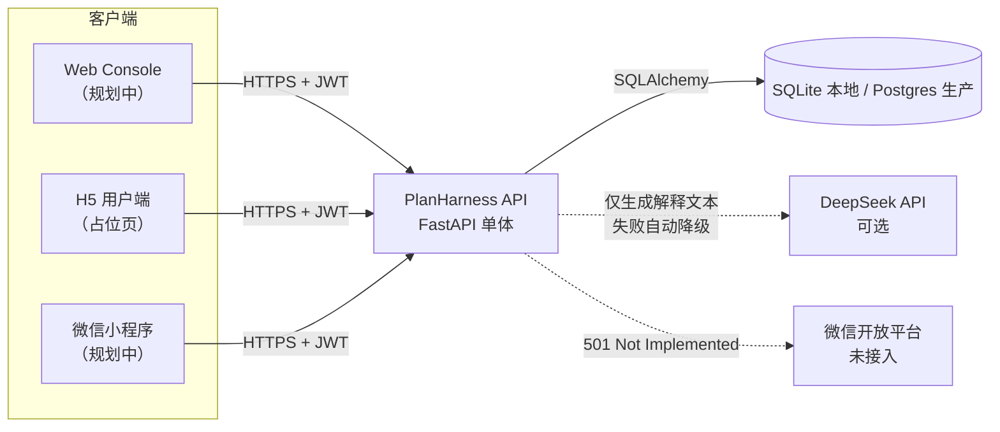
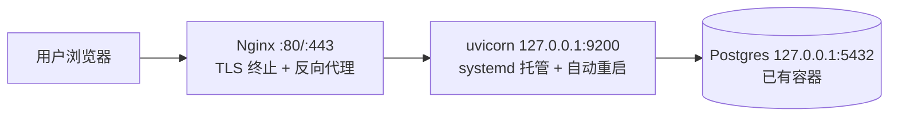
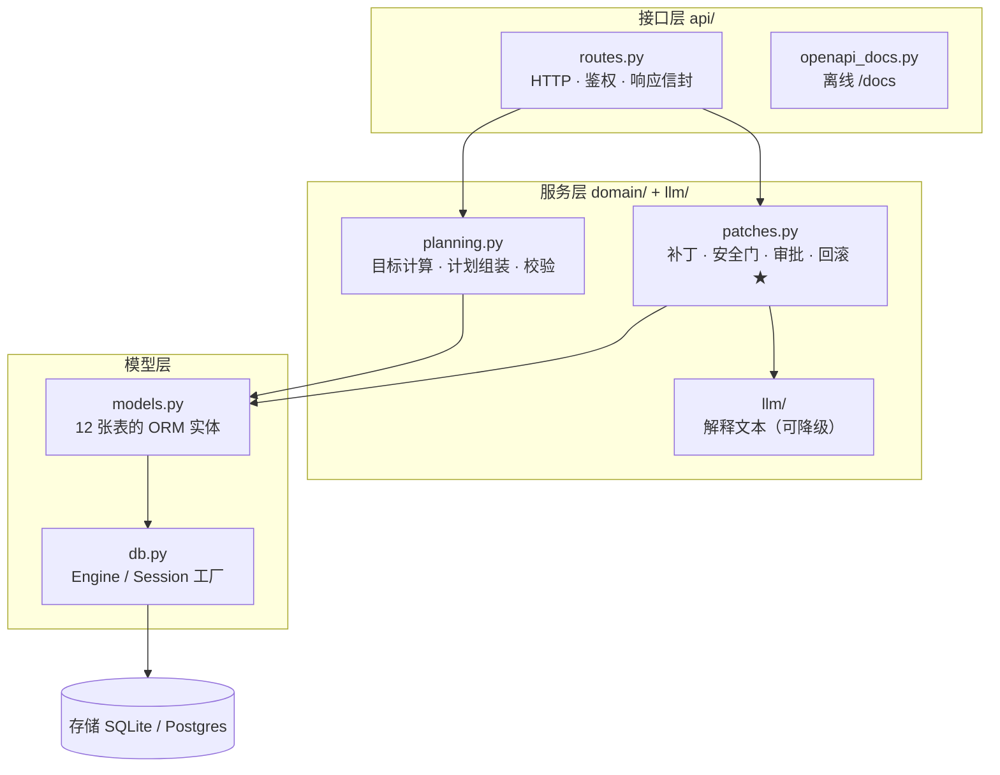
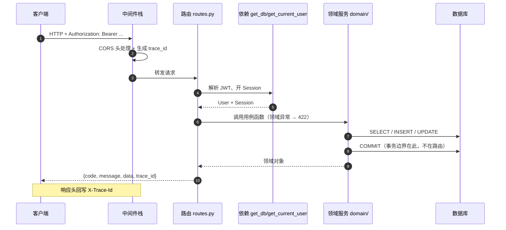
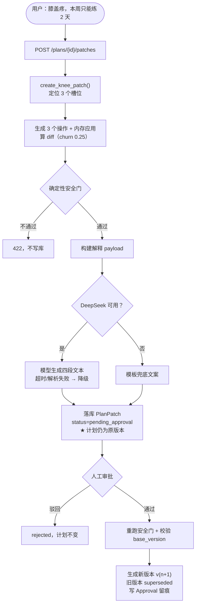
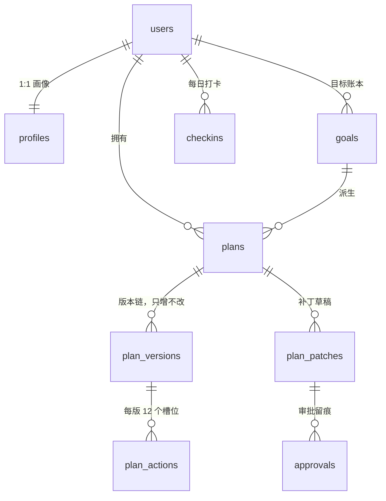
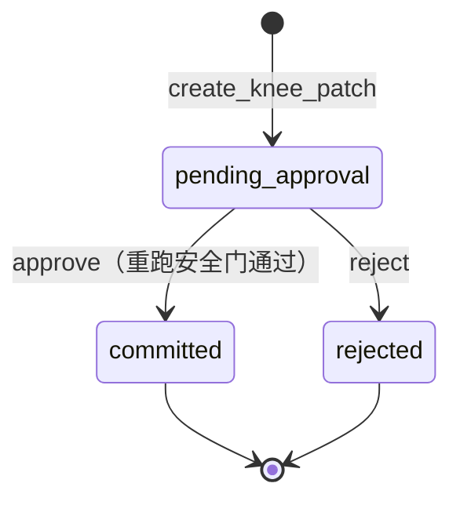

# 12 架构总结（Architecture Summary）

> 对应代码：`backend/` 工作区（20+ 个接口 / 14 张表 / 约 5000 行 / 90 个测试全绿）
> 用途：面试讲解、新人接手、以及「这个改动该放哪一层」的判断依据。
> 配套阅读：[10 代码地图与流程图](10-code-map-and-flows.md)（看代码怎么跑）、[03 领域模型与协议](03-domain-and-protocol.md)（看表结构与契约）。

---

## 0. 一页速览

| 维度 | 结论 |
| --- | --- |
| **架构风格** | 分层单体（Layered Monolith），模块化单体（Modular Monolith） |
| **领域模型** | **贫血模型**（Anemic Domain Model）—— 实体只有字段，规则外置到服务层 |
| **服务层风格** | Service Layer + Transaction Script（按用例组织的模块函数） |
| **是否 DDD** | **否**。借用了聚合根、值对象、规格校验、显式状态机、领域异常 5 件工具，缺仓储抽象/充血实体/领域事件/防腐层 |
| **一致性模型** | **版本化追加（append-only）**：当前版本指针 + 不可变历史，回滚是「再提交一个版本」 |
| **事务边界** | 一个请求一个 Session，`db.commit()` 即事务边界；无 Unit of Work |
| **身份体系** | 无状态 HS256 JWT；demo / 手机号密码（scrypt）/ 微信（未接入）；用 `token_version` 实现撤销 |
| **上下文装配** | `ContextBuilder` 预算裁剪：required 永不丢 → 按优先级丢 → 高价值长段落优先截断；每次装配落 `context_snapshots` |
| **图状态持久化** | LangGraph checkpointer：`auto` 看数据库方言 —— Postgres 用 `PostgresSaver`，否则内存（dev）。用 `CHECKPOINTER_BACKEND` 可强制 |
| **LLM 角色** | 只生成**解释文本**，无写权限；超时/异常/未配置自动降级为模板文案 |
| **部署形态** | 单进程 uvicorn，systemd 托管，Nginx 反代（生产 `127.0.0.1:9200`） |
| **外部依赖** | 数据库（SQLite/Postgres）、DeepSeek API（可选）、微信开放平台（未接入，返回 501） |

**三条不可动摇的设计约束**（所有改动都不能违背）：

1. **审批前不落盘**：补丁生成阶段绝不写 `plan_versions`。
2. **安全门确定性**：禁忌动作、热量下限这类判断写死在代码里，不交给模型。
3. **历史不可变**：版本只增不改，任何「回退」都是新增版本。

---

## 1. 系统上下文（C4 Level 1）



要点：**只有数据库是硬依赖**。DeepSeek 挂了、微信没配，业务功能全部可用（降级 / 501）。

---

## 2. 部署视图（C4 Level 2）

**开发**：`uvicorn :8000` + 本地 SQLite 文件，零依赖启动。

**生产**（见 [deploy/README.md](../deploy/README.md)）：



| 组件 | 位置 | 说明 |
| --- | --- | --- |
| API 进程 | 宿主机 systemd | 2C2G 机器上不再跑容器，避免重复起 Postgres |
| 数据库 | 复用已有 `pg` 容器 | 只绑 `127.0.0.1`，不对公网暴露 |
| 静态资源 | 打进 wheel | Swagger UI 1.8MB，见 `app/static/swagger/` |
| 配置 | `/etc/planharness/planharness.env` | `640 root:planharness`，不进 Git |

> `docker-compose.example.yml` / `Caddyfile` 是**备选方案**，当前不使用，别混用。

---

## 3. 分层架构



### 每层的职责与禁止事项

| 层 | 应该做 | **禁止**做 |
| --- | --- | --- |
| 接口层 `api/` | 解析请求、鉴权、调服务、把异常映射成 HTTP 状态码、包统一信封 | 写业务规则、直接提交事务（`checkins` 是已知例外） |
| 服务层 `domain/` | 全部业务规则、校验、状态迁移、事务提交 | 依赖 HTTP / FastAPI（当前已做到） |
| 适配器 `llm/` | 调外部模型、解析、降级 | 决定计划内容（只能解释） |
| 模型层 `models.py` | 表结构、字段约束 | 放业务规则（当前是贫血的） |

### 依赖方向规则（可自动校验）

```
api/  →  domain/  →  llm/  ·  models/  ·  db/
         ↓
      models/ → db/
```

**只允许向下**。当前实际状态（已用命令验证）：

```bash
# 1) 领域层不依赖接口层 —— 应为空
grep -rn "from app.api\|import app.api" backend/app/domain backend/app/llm
# 2) 领域层不关心 HTTP —— 应为空
grep -rn "HTTPException\|fastapi" backend/app/domain backend/app/llm
# 3) 路由层不直接提交事务 —— 只应剩 checkins 一处（已知债）
grep -rn "db.commit" backend/app/api
# 4) /docs 不引用外部 CDN —— 应输出 0（需要服务已启动）
curl -s localhost:8000/docs | grep -c "https://cdn"
```

### 现存的偏差（诚实记录）

`/api/v1/checkins` 的读写直接写在 `routes.py`（约 294–331 行），**没有 domain 模块**，也直接 `db.commit()`。
说明分层是「按用例逐个加」的，不是先定架构再填代码。这是 P0 的合理取舍，但要记在技术债里（§11）。

---

## 4. 模块清单

| 模块 | 行数 | 职责 | 关键导出 |
| --- | --- | --- | --- |
| `main.py` | 73 | 应用工厂：建表 → 灌种子 → 中间件 → 路由 → 文档 | `create_app()` |
| `config.py` | 48 | 配置（环境变量 / `.env`） | `Settings`、`get_settings()` |
| `db.py` | 34 | Engine / Session 工厂 | `Base`、`make_engine()` |
| `models.py` | 282 | 12 张表的 ORM 定义 | 各实体类 |
| `schemas.py` | 147 | 接口出入参（Pydantic v2） | `*In` / `*Out` |
| `auth.py` | 134 | JWT 签发/校验、token 撤销、scrypt 密码哈希 | `issue_token()`、`get_current_user()`、`hash_password()` |
| `seed.py` | 130 | 演示数据（固定 ID，幂等） | `seed_demo()`、`DEMO_*` |
| `openapi_docs.py` | 92 | 离线 `/docs` + `/static` 挂载 | `mount_api_docs()` |
| `api/routes.py` | 331 | 13 个 HTTP 接口 | `router` |
| `domain/planning.py` | 389 | 目标计算、计划组装、两道校验 | `generate_plan()` |
| `domain/patches.py` | 461 | **补丁 / 安全门 / 审批 / 回滚（核心）** | `create_knee_patch()`、`approve_patch()` |
| `llm/context.py` | 325 | **上下文装配**：优先级/顺序/预算裁剪/截断 | `ContextBuilder`、`ContextBundle`、`ContextBudgetError` |
| `llm/prompts.py` | 68 | 构建解释用的 payload 与 messages | `build_explanation_payload()` |
| `llm/deepseek.py` | 95 | DeepSeek 客户端 + 输出解析 | `DeepSeekExplainer` |
| `llm/fallback.py` | 23 | 确定性兜底文案 | `fallback_explanation()` |
| `static/swagger/` | 1.8MB | 离线 Swagger UI 资源 | — |
| `agent/patch_graph.py` | 297 | LangGraph 审批流程：prepare → interrupt → commit → **verify →（失败）rollback** | `build_patch_graph()` |
| `agent/checkpointer.py` | 118 | dev 内存 / prod Postgres 的选择、连接池与 setup | `make_checkpointer()`、`resolve_backend()` |
| `agent/checkpoint_cleanup.py` | 128 | 按 thread 清理过期 checkpoint（可 CLI / systemd timer 调用） | `purge_old_checkpoints()`、`python -m app.agent.checkpoint_cleanup` |
| `agent/verify.py` | 192 | **提交后独立验证器**：只查数据库事实，不调模型 | `verify_commit()` → `VerificationResult` |
| `evals/` | 873 | **任务级评测**：8 场景 + 10 指标 + JSON/MD 报告 | `python -m app.evals` |
| `audit.py` | 210 | **审计哈希链**：append / verify，篡改与删改可定位到 seq | `append_event()`、`verify_stream()` |
| `tests/` | 800+ | 37 个用例：api 7 / auth 6 / **context 9** / planning 4 / patches 3 / **agent 2** / prompts 2 / fallback 2 / deepseek 2 | — |

---

## 5. 运行时视图

### 5.1 一次请求的完整链路



### 5.2 核心用例：膝痛补丁（含 LLM 分支）



**LLM 的接入方式是「可注入的回调」**，不是领域层直接 import 客户端：

```python
# routes.py：装配处决定用哪个实现
explainer = DeepSeekExplainer(...)
create_knee_patch(db, user, plan_id, explainer=explainer.explain)

# patches.py：领域层只依赖一个函数签名，异常一律降级
if explainer is not None:
    try:
        explanation = explainer(payload, operations, diff)
    except Exception:
        explanation = fallback_explanation(operations, diff)
```

这带来两个性质：**LLM 不可用作不影响主流程**；**领域层可脱离网络测试**（注入假 explainer）。

---

## 6. 数据模型与聚合边界



### 聚合划分（约定边界，非代码强制）

| 聚合 | 实体 | 唯一允许修改的入口 | 不变式 |
| --- | --- | --- | --- |
| **Plan**（核心） | `plans` + `plan_versions` + `plan_actions` | `domain/planning.py`、`domain/patches.py` | ① 同一时刻只有一个 `active` 版本；② 版本号连续递增；③ 旧版本置 `superseded` 而非删除；④ `plans.current_version` 是唯一真相 |
| **PlanPatch** | `plan_patches` + `approvals` | `domain/patches.py` | ① 只能从 `pending_approval` 迁移；② 提交时 `base_version` 必须等于当前版本；③ 审批记录只追加 |
| **User** | `users` + `profiles` | `seed.py`（P0 无注册流程） | 一个用户一份画像 |

> 📌 `constraints`（约束账本）、`reviews`（周复盘）、`agent_runs`（运行记录）三张表是 **P1 预留**：
> 表结构已建，但当前代码**没有任何写入**。演示时别把它们讲成「已实现」，见 §11 债 8。

> ⚠️ 这是**约定**，不是强制。任何人写 `db.add(PlanVersion(...))` 都能绕过安全门。合并 §11 的演进第 1 步（实体加行为）可以把部分不变式变成代码结构保证。

### 为什么「版本只增不改」是最重要的决策

- **可追溯**：任意时刻都能回答「v3 是怎么来的、由谁批准的」。
- **可回滚**：回滚 = 用旧内容再提交一个版本，历史不被篡改。
- **可对比**：diff / churn 指标天然可比（同一份基线）。
- 代价：存储涨得快（12 条动作 × 每次变更），P0 数据量下可忽略。

---

## 7. 状态机

### 7.1 补丁状态



说明：`draft` 是表默认值，**当前流程不经过它**（创建即 `pending_approval`）。要么删掉这个默认值，要么补一个真正的草稿阶段 —— 属于小债，见 §11。

### 7.2 版本状态

| 状态 | 含义 | 迁移 |
| --- | --- | --- |
| `active` | 当前生效版本 | → `superseded`（被新版本替换） |
| `superseded` | 历史版本，只读 | 终态（回滚会新建版本，不改它） |

**幂等性**：`approve_patch` 对已 `committed` 的补丁重复调用，直接返回当前版本，不报错、不重复建版本。

---

## 8. 关键设计决策（ADR）

| # | 决策 | 理由 | 代价 |
| --- | --- | --- | --- |
| **ADR-01** | 分层单体，不拆微服务 | 一周冲刺、单人、单业务域；事务天然一致 | 无法独立扩容；将来拆分要先抽边界 |
| **ADR-02** | 贫血模型 + 服务层，不上 DDD | 规模小（3 种操作 / 12 槽位 / 5 个状态迁移），DDD 全套成本远超演示价值 | 不变量靠调用者自觉；见 §11 |
| **ADR-03** | 版本化追加，不原地更新 | 审计、回滚、diff 可比性 | 存储增长；查询要带版本条件 |
| **ADR-04** | 安全门确定性，LLM 只解释 | 可解释、可测试、可复现；模型不可靠 | 规则写死，扩展新场景要改代码 |
| **ADR-05** | 补丁两阶段：先草稿，审批后落版本 | 满足「人工把关」的产品诉求，避免 Agent 越权写库 | 多一次状态查询与并发校验 |
| **ADR-06** | 统一响应信封 + trace_id | 三端一致；排障能串联日志与前端 | 响应多一层，OpenAPI 里响应结构变空（未配 response_model） |
| **ADR-07** | 领域层直接持 `Session`，不做仓储 | 少一层抽象，SQLAlchemy 已足够 | 领域层与 ORM 绑死；业务测试要建库 |
| **ADR-08** | Swagger UI 本地内置 | CDN 在国内被重置 → `/docs` 白屏 | 仓库 +1.8MB |
| **ADR-09** | 密钥只走环境变量，`.env.example` 只放占位符 | 防止密钥进 Git；模板可提交 | 部署多一步配置 |
| **ADR-10** | 无状态 JWT + `token_version` 撤销，密码用标准库 scrypt | 不引入会话存储；改密/强制下线能立刻生效；零新依赖 | 每次请求多查一次库；无 refresh token，7 天后需重新登录 |
| **ADR-11** | 上下文显式装配：priority 决定丢谁、order 决定排哪；required 超预算抛错由调用方降级 | 上下文从「隐式拼字符串」变成可测、可复现、可解释 | 多一层抽象；token 是估算值，截断有信息损失 |

### 需要展开的四条

**ADR-04 为什么不让 LLM 决定计划内容？**
因为要证明的核心命题是「Agent 不可靠 + 确定性护栏能兜住」。如果让模型参与生成，安全门就成了「事后擦屁股」，churn 也不可控。当前设计里，模型的输出**只进 `validation.explanation` 一个字段**，无法影响 `plan_versions` —— 这是可以拿来讲的架构边界。

**ADR-05 为什么值得多一个状态？**
「审批前不写库」是这个项目最容易被追问的点。它把「Agent 能不能改用户的计划」这件事，从提示词约束变成了**数据模型约束**：没有 `approve`，就没有新版本。

**ADR-10 无状态 JWT 怎么做到「能撤销」？**
JWT 的卖点是服务端不存会话，代价是**签出去的 token 收不回来**——用户改密码、手机丢了想强制下线，旧 token 在有效期内依然通行。这里的解法是在 `users` 上存一个 `token_version`，签发时把当前值写进 `ver` claim，`get_current_user` 每次请求比对一次：

```
改密码 → users.token_version += 1
       → 旧 token 里的 ver 还是旧值 → 对不上 → 401 token revoked
       → 重新登录拿到的新 token 带新 ver → 继续可用
```

三个细节值得注意：

1. **代价只有一次额外的查库**——而 `get_current_user` 本来就要查库（确认用户没被删），所以净成本为零。
2. **`claims.get("ver", 0)` 的默认值 0 是故意的**：灰度期间老 token 没有该字段，配上 `token_version=0` 的用户仍可通过，不会一刀切把所有人踢下线。
3. **密码哈希选标准库 `hashlib.scrypt`**：`scrypt$n$r$p$salt$hash` 自带参数，将来调高强度不影响老密码；不引入 `passlib`/`bcrypt` 依赖；比较用 `hmac.compare_digest` 防时序攻击。

已知缺口：**没有 refresh token**，access token 有效期 7 天，泄露窗口偏大。真实产品应改为「access 30 分钟 + refresh 7 天（存库可撤销）」，属 P1。

**ADR-11 为什么要把「上下文」做成一个显式的 builder？**
模型答得不对时，光看输入输出复现不了 —— 因为上下文是动态裁剪过的。做法是把「喂给模型什么」变成一个可计算的对象：

```
7 段候选材料 → ContextBuilder(预算) → ContextBundle(messages + 统计)
```

三条规则支撑起它：

1. **required 永不丢**（系统边界、约束、目标）。required 超预算时**抛 `ContextBudgetError`**，由 `create_knee_patch` 捕获并降级为模板文案 —— 宁可没有模型解释，也不能给「没看到膝盖疼」的解释。
2. **priority 只决定丢谁，order 只决定排哪**。两者混用一个数字，会导致「调高重要性」顺手改变正文位置。
3. **截断是概率赌注，所以要留痕**：优先级 ≥ 50 且剩余额度 ≥ 30 时，装不下的段落截断保留开头（按行边界，不切半个 JSON），并在末尾加「……（已截断）」防止模型把残文当全文。截断事实写进 `sections[].truncated` 与 `compression_method`。

**代价**：token 是估算值（1 token ≈ 3.5 字符，留了余量）；截断丢信息且不可逆。缓解手段是「快照落库 + 将来用评分集对比截 vs 不截」，而不是继续拍脑袋调阈值。

---

## 9. 横切关注点

| 关注点 | 实现位置 | 做法 |
| --- | --- | --- |
| 鉴权 | `auth.py` | HS256 JWT，`get_current_user` 依赖；四道校验：带了 token → 签名/未过期 → 用户存在 → `ver` 与 `token_version` 一致。任一失败 → 401 |
| 账号 | `api/routes.py` + `auth.py` | `POST /auth/register`（scrypt 哈希 + 自动建 Profile）、`POST /auth/login`；失败话术统一，不泄露手机号是否存在 |
| 可观测 | `main.py` 中间件 | 每请求一个 `trace_id`（可透传 `X-Trace-Id`），响应头回写 |
| 错误映射 | `api/routes.py` | 领域异常 → 422；找不到/越权 → 404；未配置 → 501；其余 → 500 |
| 越权防护 | `_owned_patch` / `_load_plan` | 不属于当前用户的资源一律 404，不泄露存在性 |
| 配置 | `config.py` | 环境变量 > `.env` > 默认值；`lru_cache` 单例 |
| 降级 | `llm/deepseek.py` + `fallback.py` | 未配置/超时/解析失败 → 模板文案 |
| 上下文预算 | `llm/context.py` | `CONTEXT_TOKEN_BUDGET`（默认 2000）；required 超预算 → `ContextBudgetError` → 调用方降级 |
| 图状态 | `agent/checkpointer.py` | `CHECKPOINTER_BACKEND=auto/memory/postgres`；Postgres 模式用连接池（默认上限 5），启动时 `setup()` 建表，退出时 lifespan 关池 |
| 数据留存 | `agent/checkpoint_cleanup.py` | `python -m app.agent.checkpoint_cleanup --days 30 --dry-run`；建议 systemd timer 每周跑 |
| CORS | `main.py` | 白名单来自配置，逗号分隔 |
| 文档 | `openapi_docs.py` | 离线 Swagger，`persistAuthorization` 免重复登录 |

---

## 10. 质量属性 → 机制映射

面试时按这张表讲，比背框架名有用：

| 质量属性 | 具体机制 | 可验证方式 |
| --- | --- | --- |
| **安全** | 确定性安全门（禁忌动作、训练日上限、热量下限） | `test_targets_are_in_safe_range`、`test_aggressive_small_profile_is_rejected` |
| **可控（有边界）** | LLM 只输出文本，无写权限 | 代码边界（`explanation` 字段） |
| **可审计** | `approvals` 表只追加（只记「谁在何时批准/驳回」） | 查询审批记录 |
| **可回滚** | 版本化追加，回滚=新版本 | `test_rollback_creates_new_version` |
| **低 churn** | diff 指标（changed/total、unnecessary_churn） | `test_knee_patch_is_pending_until_approved`（3/12 = 0.25） |
| **可测试** | 领域层无 HTTP 依赖；注入式 explainer | 26 个 pytest，无网络 |
| **可运维** | trace_id、健康检查真打库、systemd 重启 | `/api/v1/health` |
| **离线可用** | 内置 Swagger + 模板兜底 | `test_docs_uses_local_swagger_assets` |
| **可撤销** | `token_version` + `ver` claim 比对 | `test_token_is_revoked_after_version_bump` |
| **上下文可解释** | 每次装配写 `context_snapshots`（保留了哪些、丢了哪些、是否截断） | `test_context.py` 9 个用例 |
| **完成可验证** | 提交后跑独立验证器（版本指针/审批记录/禁忌动作/churn），结论写 `agent_runs.output.verification`；**不通过自动回滚**到提交前版本，接口返回 409 | `test_agent_graph.py::test_verify_failure_triggers_auto_rollback` |
| **可防篡改** | 每条审计事件带 `payload_hash/prev_hash/hash`；`/audit/{id}/verify` 返回 `valid` 或 `broken_at` | `test_audit.py`（篡改 payload / 删中间事件） |
| **成本可控** | 读 DeepSeek 真实 `usage` 写 `agent_runs.tokens_in/out`、`output.cost_cny`；prompt 超预算不调用，用量超限标 `budget_exceeded` | `test_llm_cost.py`、`test_runs.py::test_run_records_real_tokens_and_cost` |

---

## 11. 已知技术债与演进路线

| # | 债 | 影响 | 修复成本 | 优先级 |
| --- | --- | --- | --- | --- |
| 1 | `operations` 是 `list[dict]`，契约不落在类型上 | 读代码要靠追构造点；脏数据只能运行时炸 | ~20 分钟（Pydantic 判别联合） | **高** |
| 2 | ~~`patches.py` 中 `reason_text` 尾逗号 → tuple~~ | ~~发给 DeepSeek 的 `reason` 变成数组~~ **已修复** | — | ✅ |
| 3 | 实体无行为，状态迁移散在函数里 | 「审批前不写库」只靠调用顺序保证 | ~30 分钟（`PlanVersion.supersede()` 等） | 中 |
| 4 | `checkins` 无 domain 模块，路由直接 commit | 分层不一致，规则将来容易写两遍 | ~15 分钟（`domain/checkins.py`） | 中 |
| 5 | 路由未声明 `response_model` | `/docs` 里响应结构为空，前端靠猜 | ~1 小时（信封泛型化，牵前端） | 中（等 API 冻结） |
| 6 | `draft` 状态定义了但流程不经过 | 状态机图与实际不符 | 5 分钟（删默认值或补草稿阶段） | 低 |
| 7 | 单测覆盖不足：`approve` 的 stale 分支、越权 404 未直接测 | 回归风险 | ~30 分钟 | 低 |
| 8 | 预留表：`constraints`、`reviews` 仍无写入；`agent_runs` 已开始写入（每次创建补丁一条） | 模型与实现部分对齐 | 继续补或明确标注为 P1 | 中 |
| 9 | **`SECRET_KEY` 仍是公开占位符**（`CHANGE_ME_...`，两份 `.env` 都是） | 任何人可伪造任意 `user_id` 的 token；本地无害，上生产等于没有密钥 | 1 分钟（换成 `secrets.token_urlsafe(48)`） | **高** |
| 10 | 无 refresh token，access 有效期 7 天 | token 泄露后窗口期偏长 | P1：access 30min + refresh 7d（存库可撤销） | 低（P1） |
| 11 | 无登录限流、无失败次数锁定 | 密码可被暴力破解 | 加 Redis/内存计数 | 中 |
| 12 | token 估算用字符数/3.5，不是真分词器 | 预算判断有偏差（故意估高留余量） | 换 tiktoken 或按实际响应 usage 校准 | 低 |
| 13 | 截断阈值（优先级 50 / 最少 30 token）是拍的 | 可能截得过多或过少 | 用 evals 对比「截 vs 不截」质量后调参 | 中 |
| 14 | ~~LangGraph 用内存 checkpointer~~ | 已按环境切换：prod → `PostgresSaver`，dev → 内存 | — | ✅ |
| 15 | ~~checkpointer 单连接、未上连接池~~ | 已改 `psycopg_pool.ConnectionPool`（`CHECKPOINTER_POOL_SIZE`，默认 5） | — | ✅ |
| 16 | ~~checkpoint 三张表无清理策略~~ | 已有 `app/agent/checkpoint_cleanup.py`（按最后活跃时间保留 N 天，配 systemd timer） | — | ✅ |

### 最小演进路径（不推翻结构）

```
第 1 步（30 分钟）  实体充血：PlanVersion.supersede() / PlanPatch.mark_committed() / Plan.active_version()
第 2 步（20 分钟）  operations → app/domain/operations.py（Pydantic 判别联合）
第 3 步（15 分钟）  checkins 挪进 domain/checkins.py
第 4 步（1 小时）   response_model：Envelope[X] 泛型，让 /docs 显示响应结构
第 5 步（可选）     domain 层改吃仓储函数，业务测试脱离数据库
```

每一步都**不动数据库结构、不改 API 形状**。

**什么时候才该上重 DDD**：出现第二个业务域（社区 / 电商 / 支付）、多人并行修改同一聚合、或需要把某模块独立部署时。现在都不满足。

---

## 12. 明确不在范围内

- ❌ 微服务 / 服务网格 / 消息队列
- ❌ CQRS / 事件溯源（只用了「追加式版本」的思想，不是完整 ES）
- ❌ 多租户、水平分库
- ❌ 自由聊天、多 Agent 编排、GraphRAG（README 已锁定）
- ❌ 医疗诊断：所有文案与规则都以「非医疗建议」为边界

---

## 13. 新代码该放哪里？（决策树）

```
要加一个新接口？
  └─ 只在 routes.py 加路由，只做：解析 → 鉴权 → 调服务 → 包信封

有业务规则（校验、计算、状态迁移）？
  └─ 放 domain/，按用例新建模块（如 domain/reviews.py）
  └─ 规则要能被单独测试 → 函数签名里不要出现 Request/HTTPException

要调外部服务（模型、短信、支付）？
  └─ 仿照 llm/：适配器 + 降级 + 可注入，领域层只依赖函数签名

要加表/字段？
  └─ models.py + seed.py（需要演示数据时）+ 一个迁移说明（当前无 Alembic）

拿不准？
  └─ 先问一句：这段代码能在没有 HTTP、没有数据库的情况下被测试吗？
     能 → domain/；不能 → 它大概是基础设施代码
```

---

## 14. 一分钟讲稿（面试用）

> 「这是一个**分层单体**：Controller → Service → ORM，领域层完全不依赖 FastAPI 和 HTTP。
> 核心用例做计划修复，用三个手段保证安全：**版本化聚合**（Plan/PlanVersion 只增不改）、**确定性策略校验**（禁忌动作、热量下限写死在代码里）、**显式状态机**（补丁先 pending_approval，人工审批通过才提交新版本）。
> LLM 只负责把改动翻译成人话，**没有写权限**，超时或未配置就降级成模板文案 —— 所以模型不可靠不会影响主流程。
> 我刻意没上 DDD：这个规模（3 种操作、12 个槽位）不值得，但边界是留出来的 —— 规则全在 `domain/`，将来要抽仓储或拆服务，改动面可控。」

---

*相关文档：[10 代码地图与流程图](10-code-map-and-flows.md) · [03 领域模型与协议](03-domain-and-protocol.md) · [06 全量 P0 冲刺](06-full-scope-sprint.md) · [生产部署模板](../deploy/README.md)*
