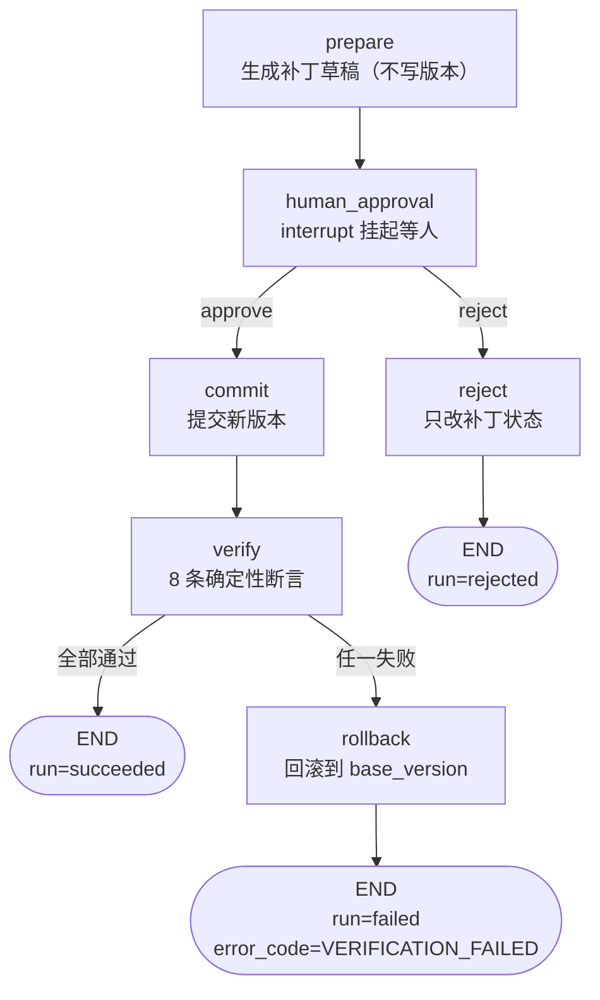

# 14 生产级 Harness 控制平面：差距与路线

> 结论：现在不是“功能太少”，而是**控制平面太薄**。  
> 不要靠加 RAG/多 Agent 解决；要把现有补丁流程包进一层可观测、可恢复、可验证的控制平面。

---

## 0. 先说清楚

你已经有一条真实的垂直切片：

```text
计划 v1 → 膝痛补丁 3/12 → 安全门 → DeepSeek 解释 → 审批 → v2 → 回滚 v3
```

但它目前只有：

- 确定性安全门
- diff
- 审批状态
- 版本/回滚
- LLM 解释 + fallback

缺少的是“任务生命周期”的控制平面：

| 能力 | 现在 | 缺口 |
| --- | --- | --- |
| Loop 生命周期 | 单次函数调用 | 轮次/步骤、停止规则、硬上限、异常分支 |
| 上下文工程 | 一个固定 payload | 分层编译、预算、压缩、快照 |
| 状态/记忆 | 业务表 + patch status | TaskState、checkpoint、跨进程恢复 |
| 沙箱/验证 | 事前 validator | 独立 verifier、环境事实、证据链 |
| 工具治理 | 直接函数调用 | tool registry、白名单、结构化错误 |
| 审计 | Approval + trace_id | 哈希链、压缩审计、编排审计 |
| 凭据/成本 | `.env` Key | 用量、预算、超限停止 |
| LangGraph | 未接 | 图、interrupt、checkpoint |

---

## 1. 控制平面架构

```text
Client / Web / Mini Program
        │
        ▼
FastAPI API
        │
        ▼
┌──────────────────────────────────────────────┐
│ Agent Runtime（LangGraph）                    │
│                                              │
│  Lifecycle Manager                            │
│    轮次 / 步骤 / 截止时间 / 最大步数 / 停止原因 │
│                                              │
│  Context Compiler                             │
│    system / goal / constraints / plan / tools │
│    token 预算 / 压缩 / 驱逐记录                │
│                                              │
│  State Store                                  │
│    TaskState + LangGraph checkpoint           │
│                                              │
│  Tool Gateway                                 │
│    白名单 / Schema / 超时 / 结构化错误         │
│                                              │
│  Verifier                                     │
│    独立上下文 / 确定性断言 / 验收证据          │
│                                              │
│  Audit Ledger                                 │
│    append-only + prev_hash + hash             │
│                                              │
│  Cost Meter                                   │
│    token / 费用 / 耗时 / 预算                  │
└──────────────────────────────────────────────┘
        │
        ├── domain：planning / patches / versions
        ├── model：DeepSeek（只解释）
        └── DB：SQLite / Postgres
```

**控制平面不替代业务，只包住业务。**

---

## 2. 七个能力，怎么落到这个项目

### 2.1 Loop 生命周期

不要只写“最多重试 3 次”这种模糊规则。要有：

```text
max_rounds = 2
max_steps = 8
deadline_ms = 20000
max_tokens = 4000
stop_reason ∈ {completed, approval_rejected, validation_failed, budget_exceeded, deadline_exceeded, max_steps}
```

每个 step 记录：

```text
run_id, round_index, step_index, node, started_at, ended_at, tokens, status
```

对应节点：

- `propose_patch` 失败 → `validate` 失败 → 重试一次 → 仍失败 → `validation_failed`
- 审批拒绝 → `approval_rejected`
- 超过预算/时间 → `budget_exceeded` / `deadline_exceeded`
- 正常提交 → `completed`

效果：

- 不会围绕同一个失败状态空转；
- Console 能看到“停在哪一步、为什么停”；
- 面试可以讲“停止条件可验证”，不是模型说完成就完成。

### 2.2 上下文工程

当前只是把补丁 payload 直接给 DeepSeek。生产化需要 `ContextBuilder`：

```text
[System Policy]        ← 版本化、按 Agent 版本生成
[Goal Card]            ← 目标、目标体重、周期
[Active Constraints]   ← 膝痛、过敏、时间；永不被压缩
[Current Plan Summary] ← 当前版本、动作数、目标热量
[Changes]              ← 本次补丁
[Tool Results]         ← 校验器/检索结果
[Recent Turns]         ← 对话（P1）
[Older Summary]        ← 可压缩
```

规则：

- 安全约束逐字保留，不压缩；
- 超过 token 预算时，先丢闲聊，再丢旧工具结果，再压缩旧对话；
- 每次运行写 `context_snapshots`：section、token 数、压缩前后、驱逐了什么；
- 记录“模型没看到什么”，否则无法解释决策依据。

效果：

- 上下文不再是“拼字符串”，而是可测试的编译过程；
- 可以做一个 30 轮目标漂移测试；
- Console 展示 context budget 和被压缩内容。

### 2.3 状态持久化与记忆

把“业务状态”和“运行状态”分开：

```text
业务状态：plans / plan_versions / plan_actions / patches / approvals
运行状态：agent_runs / task_states / checkpoints
```

`TaskState` 至少包含：

```text
run_id, user_id, session_id, goal_id, phase, plan_id, patch_id,
confirmed_facts, blockers, budget, stop_reason, completion_evidence
```

LangGraph checkpoint 负责“执行到哪”，DB 负责“业务事实是什么”。  
不要把消息历史当唯一状态。

效果：

- 进程重启后，从 `interrupt` 恢复；
- 跨请求、跨进程、跨副本可恢复；
- Console 能看到当前 phase 和 blockers。

### 2.4 沙箱与独立验证

这个项目不执行用户代码，所以不需要为了“沙箱”而硬上 Docker。  
但需要**独立验证器**：

```text
verify_plan_state(db, plan_id, expected):
  - 版本号正确
  - 无高危动作
  - 训练天数 ≤ 2
  - 热量/蛋白质在区间
  - 审批记录存在
  - 回滚后动作数与 v1 一致
```

验证器要求：

- 不调用 LLM；
- 用独立上下文/独立进程；
- 结果写 `verifications` 表：passed、assertions、evidence、trace_id；
- 失败时标记 run 失败，不允许“模型自称完成”。

如果以后加代码执行，再用容器/子进程做真沙箱。  
**现在不要假装有沙箱。**

效果：

- 完成标准是“环境事实”，不是模型自述；
- 测试可以注入非法计划，验证器必须抓住；
- 面试可以讲“独立 verifier”。

### 2.4.1 已落地：提交 → 独立验证 → 失败自动回滚

这一节不是设计稿，是**已经在跑的代码**（`app/agent/patch_graph.py` + `app/agent/verify.py`）。



**为什么把 verify 从 commit 里拆出来**

| 之前 | 现在 |
| --- | --- |
| commit 又写又验，两种失败混在一起 | commit 只写，verify 只查，各自可测 |
| 验证失败后计划停在错误状态 | 失败 → rollback 节点自动退回提交前 |
| run 卡在 `running` | 每条路径都有明确终态 |

**8 条断言**（全部查数据库，不调模型）：

| 断言 | 在防什么 |
| --- | --- |
| `patch_committed` | 补丁状态没真的变 committed |
| `approval_recorded` | 没有人工审批记录 —— 绕过审批的直接证据 |
| `current_version_matches` | 计划指针没指向新版本 |
| `version_active` | 新版本状态不对 |
| `previous_superseded` | 旧版本没被标 superseded（历史链断裂） |
| `no_forbidden_actions` | 提交后的动作里混进了膝痛禁忌动作 |
| `churn_matches_recorded_diff` | 重算 churn 与补丁记录不一致（被偷偷改过） |
| `strength_days_within_limit` | 力量训练日超过可用天数 |

**回滚语义**：回滚不是删除，而是**再提交一个新版本**（append-only）：

```
v1（12 动作）→ v2（补丁后 11 动作，验证失败）→ v3（回到 v1 内容，12 动作）
                ↑ 失败记录仍然保留，可追溯
```

**对外表现**：

- 验证通过 → `200`，body 带 `verification`
- 验证失败 → `409`，带 `rolled_back: true`、`rollback_version`、`failed_checks`
- `agent_runs` 记录 `status=failed`、`error_code=VERIFICATION_FAILED`、`output.verification` 全量断言

**故障注入测试**（证明验证器不是摆设）：

- `test_verify_detects_missing_approval_record`：删掉审批记录，验证器必须抓
- `test_verify_failure_triggers_auto_rollback`：注入验证失败，计划必须回到 12 动作、v3 的 parent 是 v2
- `test_approve_returns_409_and_rolls_back_when_verification_fails`：接口层 409 + 回滚信息

### 2.5 工具治理

现在只有 DeepSeek 解释器，没有工具层。  
先做一个最小 `ToolRegistry`：

```text
tools:
  get_profile        read
  get_plan           read
  build_knee_patch   write-draft
  validate_patch     read/check
  commit_plan        privileged（必须审批）
```

每个工具：

```text
name, schema, permission, timeout, retryable, structured_error
```

规则：

- 按角色/阶段暴露工具，不一次全量塞给模型；
- 未注册工具直接拒绝；
- 错误返回结构化：

```json
{"code":"STALE_VERSION","message":"plan changed","retryable":false,"details":{}}
```

效果：

- 模型能做的动作被白名单约束；
- 错误能指导下一步，而不是“invalid”；
- Console 可以显示工具调用和拒绝原因。

MCP 暂时不做；工具注册表 + 白名单已经能体现治理。

### 2.6 可审计性

现在有 `Approval` 和 `trace_id`，但没有防篡改审计链。

加 `audit_events`：

```text
id, run_id, seq, actor, action, payload_hash, prev_hash, hash, created_at
```

写入：

- 补丁创建
- 审批通过/拒绝
- 版本提交
- 回滚
- 工具拒绝
- 预算超限
- 上下文压缩（记录丢弃的 section 和 token 数）

`hash = sha256(prev_hash + canonical_payload)`。  
提供 `GET /audit/verify` 验证链。

效果：

- 能回答“谁在什么时候授权了什么”；
- 篡改一条记录，后续 hash 对不上；
- 面试可以讲“证据链”，不只是日志。

### 2.6.1 已落地：审计哈希链

`audit_events` 表 + `app/audit.py`，每个 `plan_id` 一条链：

```
hash_i = sha256(stream_id | seq | action | actor | payload_hash | hash_{i-1})
```

接入了 6 类事件：`patch_created` / `approval_granted` / `approval_rejected` /
`patch_committed` / `verification_failed` / `rollback_committed`。

`GET /audit/{plan_id}/verify` 会重算整条链，返回：

- `valid`：是否完整
- `broken_at`：第一个出问题的 seq
- `reason`：`payload_hash mismatch` / `prev_hash mismatch` / `seq gap`

三种攻击都有测试：改 payload、改 payload 并重算自身 hash、删掉中间一条。
局限也说清楚：能改库的人理论上可以重算整条链，所以**真要防篡改还要把最新 hash 锚定到外部**（P1）。

### 2.7 凭据与成本

现在 Key 在 `.env`，没有预算。

加：

- DeepSeek 响应 `usage` 写入 `agent_runs.tokens_in/out`；
- 估算成本；
- 每次 run 预算：`max_tokens`、`max_cost`、`deadline`；
- 超限：停止并返回 `budget_exceeded`；
- Console 显示 token/费用/耗时。

效果：

- 不会因为循环/重试烧钱；
- 可以解释“为什么这次停了”；
- 生产化必须有。

---

## 3. 优先级：不要一次做七个

### 第一优先级（现在）

1. LangGraph 粗粒度图 + interrupt + checkpoint
2. `agent_runs` 写入 + max_steps/deadline/stop_reason
3. 独立 verifier（确定性断言）

### 第二优先级

4. ContextBuilder + `context_snapshots` + 预算
5. 审批/提交/回滚的 audit hash chain

### 第三优先级

6. ToolRegistry 白名单 + 结构化错误
7. 成本预算/用量看板
8. 细粒度节点 trace、Console 真实 Run

### 暂不做

- MCP 多 Server
- 多 Agent 编排
- 真沙箱（没有代码执行，不硬上）
- RAG / 长期记忆（P1/P2）

---

## 4. 每个能力的最小验收

| 能力 | 最小实现 | 验收 |
| --- | --- | --- |
| 生命周期 | max_steps/deadline/stop_reason | 注入死循环/超时，能停 |
| 上下文 | ContextBuilder + snapshot | 预算超限时，约束仍在 |
| 状态 | LangGraph checkpoint + TaskState | 重启后能 resume |
| 验证 | 独立 verifier + 自动回滚（**已实现**） | 注入非法计划，必须失败并回滚 |
| 工具 | Registry + allowlist | 未注册工具被拒绝 |
| 审计 | hash chain | 篡改一条，verify 失败 |
| 成本 | token 统计 + 预算 | 超预算停止 |

---

## 5. 面试怎么讲

不要说“我做了生产级 Harness”。  
说：

> 我以一个计划修复场景为切片，先把安全门、审批、版本回滚做扎实；然后围绕它补控制平面：LangGraph 的 interrupt/checkpoint 管生命周期，ContextBuilder 管上下文预算，独立 verifier 用环境事实验收，audit hash chain 记录授权链，cost meter 限制预算。每一项都有一个故障注入和一条可验证指标。

这比“功能大全”更像工程能力。

---

## 6. 一句话

> **不要加更多功能，给现有流程加控制平面。**  
> 安全门/审批是“行动的边界”；生命周期、上下文、状态、验证、工具、审计、成本，才是“可靠地跑完”的工程。
