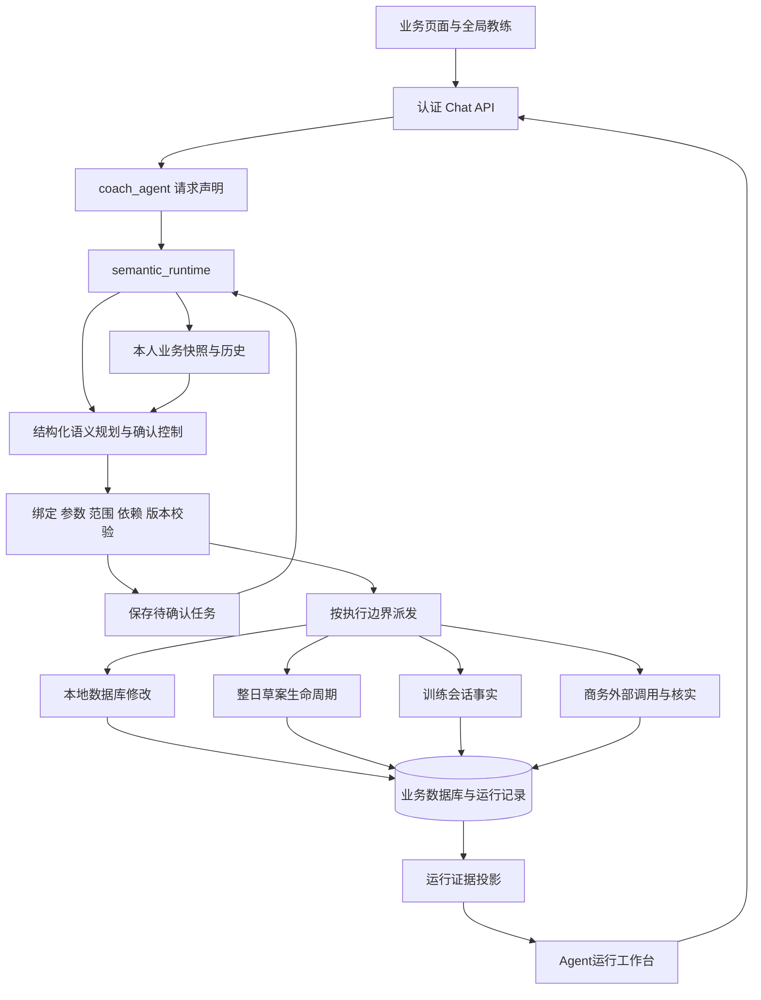

# 02 系统整体架构

面试画图时先画当前聊天主链，再补独立能力，避免把历史服务串成不存在的调用链。

## 四层职责

HTTP层确定当前用户与参数类型；编排层解释目标和管理当前任务；执行/领域层管理版本、约束和事实；存储与观测层记录实际结果。模型输出是待校验的数据，不能直接当SQL或函数执行授权。

## 两种控制入口

自然语言需要模型解释；按钮确认使用保存的pending_id/version或checkout_id/version。两者进入同一后端业务规则，不是按钮绕过Agent安全检查。页面附带context是只读提示，服务端重新读取本人数据。

## 独立路径放在哪

- `patch_graph`：独立计划补丁审批、checkpointer、提交后验证；不是上图统一聊天的必经步骤。
- `planning_agent` / `today_agent`与skill：独立生成/规划API依然有效。
- `knowledge_routes`：搜索、问答和RAG对比API；不能据此推断主聊天每轮都有检索增强。
- `legacy_*`和`intent_router`：兼容测试、CLI用途，生产聊天不调用。

## 事务和并发的准确表述

本地执行使用任务级savepoint、预期状态比较与执行日志；失败可隔离到单任务，因此结果可能partial_success。跨本地和商务调用没有统一分布式事务；外部订单不能随本地rollback消失。版本/快照摘要用于检测过期，唯一约束用于抢占幂等声明，数据库锁只覆盖相应本地临界区。

## 运行边界

`create_app`会初始化库、加法迁移与种子；测试必须隔离DB。内存/PG checkpointer属于Graph路径；业务会话持久化不依赖浏览器localStorage。生产模板单worker，不据此推导横向扩容已验收。

详细技术事实：[ARCHITECTURE](../docs/ARCHITECTURE.md)。
